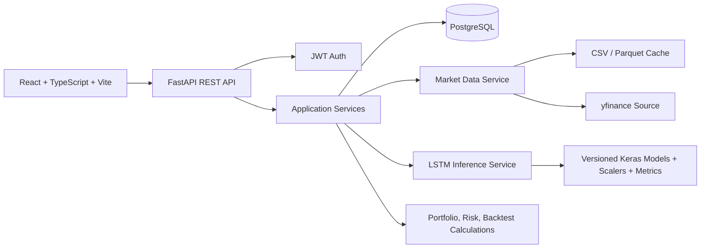

# StockMind AI - Phase 1 Architecture

This document is the Phase 1 design baseline for the existing StockMind AI repository.
It deliberately separates verified current behavior from the target architecture for the
remaining implementation phases.

## 1. Final Architecture

StockMind AI will remain a modular monolith for the B.Tech project. The browser talks to
FastAPI over JSON; FastAPI owns authentication, authorization, orchestration, and response
contracts; services own market data, portfolio mathematics, risk, backtesting, and LSTM
inference; PostgreSQL stores user and audit data; model artifacts remain versioned files on
the backend side.



### Ownership boundaries

| Layer | Responsibility |
| --- | --- |
| React pages/components | Presentation, interaction, loading/error states, chart rendering |
| `frontend/src/services` | Typed HTTP calls and token injection |
| FastAPI routers | Request validation, dependency injection, HTTP errors |
| Application services | Business rules and calculations; no UI concerns |
| SQLAlchemy models/repositories | Persistence and user-scoped queries |
| Market-data service | Fetch, validate, normalize, filter, cache OHLCV data |
| ML services | Feature preparation, training commands, artifact loading, inference, evaluation |

The recommendation engine is deterministic and rule-based. LSTM is the only prediction
model. Returns, volatility, Sharpe ratio, drawdown, allocation, P/L, and backtesting are
ordinary quantitative calculations, not additional models.

## 2. Folder Structure

### Current repository baseline

```text
backend/
  app/
    api/                 FastAPI routers
    database/            SQLAlchemy connection and models
    ml/                  indicators, preprocessing, LSTM train/predict/evaluate
    schemas/             Pydantic request/response schemas
    services/            market data, portfolio, risk, recommendation, backtest
    main.py              FastAPI application entry point
  data/                  backend data and cache
  models/
    lstm/                saved Keras models and metric reports
    scalers/             saved preprocessing scalers
frontend/
  src/
    components/          shared UI and charts
    contexts/             authentication context
    layouts/              application shell
    pages/                route-level screens
    services/             Axios API client
    types/                shared frontend contracts
tests/                    Python unit tests
docs/                     model and viva documentation
data/                     repository datasets
```

### Target additions and changes by later phases

```text
backend/app/
  repositories/           user-scoped persistence queries
  core/                   settings, security, errors, logging
  workers/                optional background training jobs
backend/alembic/          database migrations
backend/scripts/          explicit data and model training commands
frontend/src/
  hooks/                  reusable query and form behavior
  utils/                  formatting and validation helpers
  assets/                 local visual assets
```

No files are deleted by this Phase 1 design. Existing model artifacts and datasets remain
inputs to the migration and validation work.

## 3. Database Design

PostgreSQL is the deployment database. Monetary values should use fixed-precision numeric
columns rather than floating-point columns. Trading dates use `DATE`; audit timestamps use
timezone-aware timestamps. Every user-owned query must include the authenticated user ID.

### Core tables

| Table | Important columns | Constraints |
| --- | --- | --- |
| `users` | `id`, `name`, `email`, `password_hash`, `created_at` | Unique normalized email |
| `user_settings` | `id`, `user_id`, `theme`, `currency`, `risk_tolerance` | Unique `user_id`, cascade delete |
| `portfolios` | `id`, `user_id`, `name`, `created_at` | Foreign key to users |
| `holdings` | `id`, `portfolio_id`, `ticker`, `quantity`, `purchase_price`, `purchase_date` | Positive quantity/price, foreign key to portfolio |
| `watchlist_items` | `id`, `user_id`, `ticker`, `added_at` | Unique `(user_id, ticker)` |
| `prediction_runs` | `id`, `user_id`, `ticker`, `model_version`, `prediction_date`, `current_price`, `signal` | User-scoped audit record |
| `prediction_points` | `id`, `prediction_run_id`, `forecast_date`, `predicted_price` | Unique `(prediction_run_id, forecast_date)` |
| `model_versions` | `id`, `ticker`, `model_name`, `lookback`, `feature_schema`, `training_start`, `training_end`, `metrics_json`, `artifact_path` | Artifact compatibility metadata |
| `backtest_runs` | `id`, `user_id`, inputs, summary metrics, `created_at` | User-scoped simulation record |
| `backtest_trades` | `id`, `backtest_run_id`, `trade_date`, `side`, `price`, `quantity` | Foreign key to run |

The current SQLAlchemy models cover the first five core tables, plus a less normalized
prediction record. Migration work should add uniqueness, numeric types, explicit dates,
model version metadata, and backtest/prediction child records.

## 4. API Design

All routes are under `/api`. Protected endpoints require `Authorization: Bearer <token>`
and return `401` for missing or invalid credentials. Error responses expose a safe message,
never a traceback.

### Authentication and settings

| Method | Route | Purpose | Auth |
| --- | --- | --- | --- |
| POST | `/auth/register` | Create user and initial settings | No |
| POST | `/auth/login` | Issue JWT | No |
| GET | `/auth/me` | Return current user | Yes |
| GET/PATCH | `/settings` | Read/update preferences | Yes |

### Market data and forecasting

| Method | Route | Purpose | Auth |
| --- | --- | --- | --- |
| GET | `/stocks/{ticker}` | Latest quote | No |
| GET | `/stocks/{ticker}/history` | Filtered OHLCV history | No |
| GET | `/stocks/{ticker}/indicators` | Latest technical indicators | No |
| POST | `/predictions/forecasts` | Load a compatible LSTM artifact and forecast | Yes |
| GET | `/predictions/history` | Current user's prediction audit records | Yes |
| GET | `/predictions/recommendation/{ticker}` | Rule-based signal and reasons | Yes |

### Portfolio, risk, watchlist, and simulation

| Method | Route | Purpose | Auth |
| --- | --- | --- | --- |
| GET/POST | `/portfolios` | List/create portfolios | Yes |
| GET/POST | `/portfolios/{id}/holdings` | Read/add holdings | Yes |
| PATCH/DELETE | `/portfolios/{id}/holdings/{holding_id}` | Modify/remove owned holding | Yes |
| GET | `/portfolios/{id}/performance` | Current valuation and time series | Yes |
| GET | `/portfolios/{id}/risk` | Volatility, Sharpe, drawdown, concentration | Yes |
| GET/POST/DELETE | `/watchlist` | Manage current user's watchlist | Yes |
| POST | `/backtests` | Run a historical simulation | Yes |

The current API uses `/portfolio` and `/backtest` singular routes. Compatibility aliases can
be retained during migration, but new frontend code should target the resource-oriented
contract above.

## 5. LSTM Pipeline

```text
OHLCV source
  -> schema validation and date normalization
  -> chronological deduplication and invalid-value handling
  -> technical indicators and lag-safe features
  -> chronological train / validation / test split
  -> fit X and y scalers on training rows only
  -> 60-trading-day sequences, no shuffle
  -> stacked LSTM (64 -> dropout -> 32 -> dropout -> dense -> price)
  -> early stopping and best-checkpoint persistence
  -> unseen test evaluation: MAE, RMSE, MAPE, R2
  -> versioned artifact and metadata
  -> forecast service and transparent recommendation rules
```

### Required invariants

- The only learned prediction model is TensorFlow/Keras LSTM.
- Train, validation, and test ranges are chronological and explicitly reported.
- Scalers are fitted on training data only.
- Inference loads an existing compatible artifact; dashboard requests never train models.
- Recursive forecasts must update or recompute every feature used by the model. Copying stale
  OHLCV and indicator values into future windows is invalid.
- Forecast points are visibly separated from historical points and carry a forecast marker.
- Metrics are real calculated values. R2 is never labeled as accuracy.
- Evaluation should include a naive previous-close baseline so weak LSTM results are visible.

The current pipeline already has the chronological split, training-only scalers, stacked
LSTM, early stopping, checkpointing, and four requested metrics. It still needs compatible
artifact metadata, non-blocking/offline training, and a corrected multi-step feature update.

## 6. Frontend Page Map

| Route | Screen | Main data |
| --- | --- | --- |
| `/` | Landing | Product entry and visual data story |
| `/login`, `/register` | Authentication | Auth API |
| `/dashboard` | Overview | Portfolio summary, watchlist, recent predictions |
| `/stock/:ticker` | Stock Analysis | Quote, history, indicators, LSTM forecast, signal |
| `/predictions` | Forecast Workspace | Horizon selection, forecast table, metrics |
| `/portfolio` | Portfolio | Holdings, valuation, allocation, performance |
| `/risk` | Risk Analysis | Volatility, Sharpe, drawdown, HHI/allocation |
| `/backtest` | Historical Simulation | Inputs, equity curve, trades, disclaimer |
| `/watchlist` | Watchlist | User-owned tickers, quotes, signals |
| `/history` | Prediction History | User-owned forecast audit records and filters |
| `/settings` | Settings | Persisted profile and preferences |

The application shell uses a collapsible sidebar, responsive content region, route-level
loading skeletons, bounded error states, and a shared `BackgroundGlow` treatment.

## 7. UI Design System

- **Visual direction:** dark analytical fintech workspace, dense enough for scanning but with
  clear hierarchy and generous chart readability.
- **Surface:** near-black/deep navy base, restrained radial indigo glow, faint grid texture,
  translucent charcoal panels, thin cool borders, and soft shadows.
- **Semantic color:** emerald for positive values, red for negative values, blue/indigo for
  interaction, amber for warnings only.
- **Typography:** one expressive display face for page titles and a highly legible sans-serif
  for data, labels, and controls; numeric values use tabular figures.
- **Components:** compact metric panels, chart frames, sortable data tables, segmented
  controls, icon buttons with tooltips, badges for signal states, and skeletons for every
  asynchronous surface.
- **Motion:** short page entrance and chart reveal transitions, restrained hover feedback,
  and sidebar transitions. No motion should delay data access or obscure values.
- **Responsive behavior:** desktop-first analytical density, collapsing sidebar on tablet,
  stacked metric/chart regions on small screens, and horizontally scrollable data tables.
- **Accessibility:** keyboard-visible focus, semantic headings, sufficient contrast, labels for
  icon-only controls, and no information conveyed by color alone.

## 8. Development Roadmap

### Phase 1 - Architecture (this phase)

- Audit current repository and identify real implementation boundaries.
- Establish this architecture, data contract, model invariants, and UI system.
- Correct the confirmed backend import blocker.

### Phase 2 - Foundation

- Add environment-backed settings and migrations.
- Remove silent database fallback for deployed PostgreSQL.
- Harden JWT dependencies, ownership checks, CORS, and safe error handling.
- Add reproducible backend/frontend run configuration and Dockerfiles.

### Phase 3 - Data pipeline

- Centralize market-data schema validation and exact period filtering.
- Guarantee adjusted-price semantics and cache behavior.
- Add leakage and indicator contract tests.

### Phase 4 - LSTM

- Add explicit training/evaluation commands and model version metadata.
- Fix recursive feature updates and prevent request-time training.
- Add forecast compatibility checks and baseline comparison.

### Phase 5 - Domain services

- Finish portfolio CRUD and user isolation.
- Add persisted performance history, watchlist uniqueness, and prediction audit records.
- Correct backtest execution timing and trade accounting.

### Phase 6 - Frontend integration

- Replace synthetic chart data with API responses.
- Complete typed contracts, settings persistence, auth guards, loading states, and errors.
- Connect every page to a functional backend workflow.

### Phase 7 - Verification and documentation

- Add API/auth/database integration tests and focused frontend tests.
- Run backend tests, frontend typecheck/build, and Docker smoke tests.
- Update README, model documentation, viva guide, limitations, and reproducible setup.

## 9. Verified Issues To Carry Forward

These are intentionally recorded rather than silently fixed during Phase 1:

1. Current authentication falls back to a demo user for invalid or missing tokens.
2. Holding update/delete operations are not yet scoped to the authenticated owner.
3. PostgreSQL startup can silently fall back to SQLite.
4. CORS includes a wildcard origin with credentials enabled.
5. Local CSV and remote data paths do not enforce identical adjusted-OHLCV contracts.
6. Forecasting can train synchronously when artifacts are missing.
7. Recursive forecasts retain stale non-close features.
8. Backtesting executes signals using same-day close-derived indicators.
9. Some frontend portfolio history is synthetic rather than API-backed.
10. Docker Compose references Dockerfiles that are not currently present.

These items are implementation work for the approval-based phases that follow. No fabricated
model metrics or portfolio results are introduced by this document.